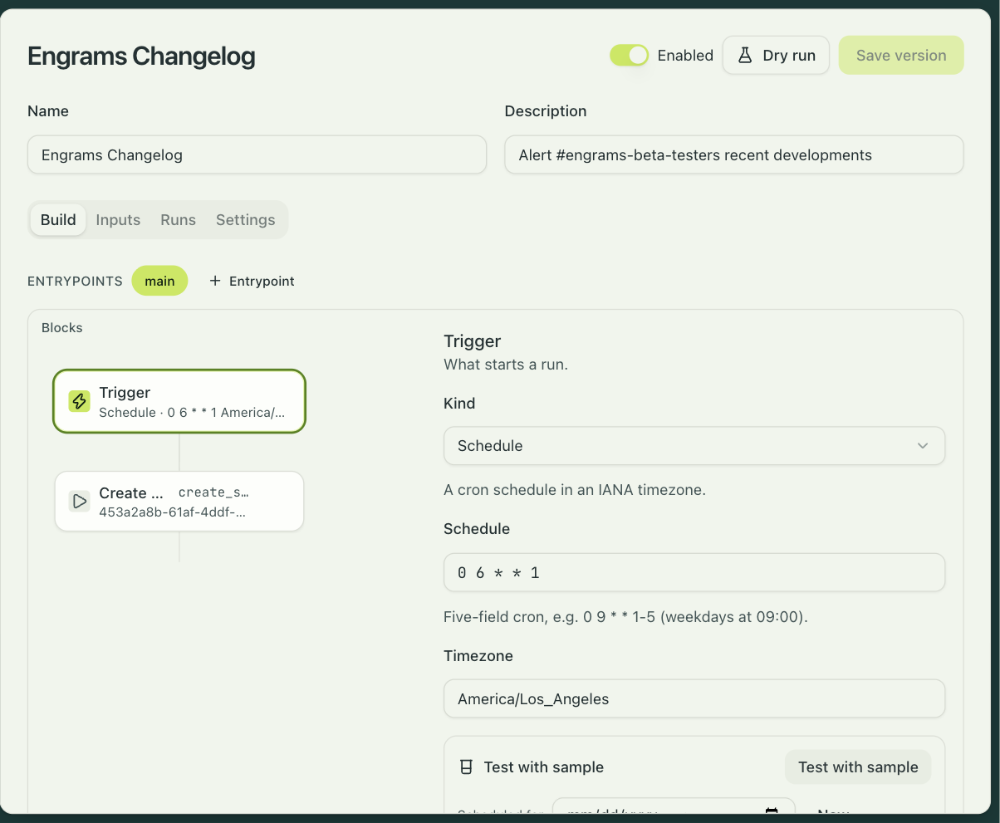
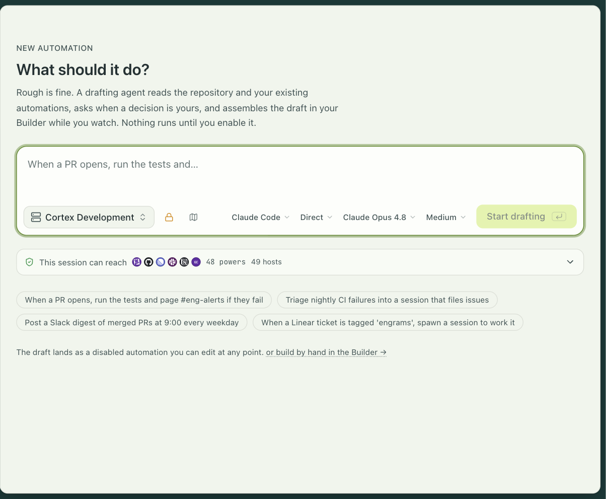

An automation is an agent with ways in. The agent is a profile and a prompt. A way in is
something that happens: a pull request opening, a Slack mention, a schedule, a webhook from
a system you run. When it happens, the way in's steps run, and then the event reaches the
agent. It is the part of engrams that turns "an agent I can talk to" into work that happens
without anyone typing a prompt.

The agent's **scope** says how many agents there are. One agent for each event starts a
fresh session every time. One agent for each Slack thread, pull request, or Linear issue
keeps one session per thread, pull request, or issue, and every later event for the same
one reaches that session. One agent for the whole automation is a standing agent that
every event reaches. Each way in says what it does with the agent: starts it, reaches it
only when it is already running, closes it, or runs its own steps and no agent.

Every run is short and durable: it runs the way in's steps, hands the event to the agent,
and ends. The agent's session outlives the run. A run survives a server restart and picks
up where it was.



## Two ways to write one

**Describe it.** Settings → Automations → New automation opens a prompt: "When a PR opens,
run the tests and page #eng-alerts if they fail." A drafting agent reads your repository and
your existing automations, asks when a decision is yours, and assembles a draft on the
canvas while you watch. The draft lands disabled. You edit it by hand, and the agent and you
can edit at the same time.

**Build it.** The builder is a canvas: one column per way in, with its trigger as the first
node and its steps below, and the automation's one Agent node under every column. A plus
sign on any edge inserts a step, and an inspector on the right edits the selected node. The
Agent node's inspector holds the profile, the prompt, the scope as a dropdown (each event,
each Slack thread, each Slack channel, each pull request, each Linear issue, the whole
automation, or a key of your own), and the Slack reply switch. The trigger's inspector
holds what the way in does with the agent. The step menu is grouped by purpose, with the
engine's internals under Advanced. In any text field, type `${{` and the field completes
the variables the step can read: the trigger, the inputs, the event's fields, and the
outputs of the steps above, each with a preview from the latest delivery. Nothing here is
JSON in disguise; when the server rejects a definition, the error points at the node and
the field.

**Try it.** The Try it button in the header renders the draft as it is on screen, unsaved
edits included, against the latest delivery the trigger would see, and shows what each block
would do, which filters pass, and which fields did not render. Nothing runs. A new
automation can be tried before it is created. Dry run goes further on a saved automation: a
real run that boots no session and posts nothing.

Every save is a new version. Runs that are in flight finish on the version they started with,
and the Settings tab shows the version history with a diff.



## Triggers

| Trigger | Fires on | You set |
|---|---|---|
| Integration event | An event from GitHub, Slack, or Linear | the provider, the event keys, and a scope: an explicit list, or the keys of one of your map inputs |
| Schedule | A cron expression in an IANA timezone | the schedule and the timezone; one schedule per automation |
| Webhook | A signed request from a system without a connector | a registration (see below), the event keys, and an optional filter on the payload |
| Manual | The Run now button | nothing |

GitHub events cover pull requests opening, updating, and closing, review comments, issues,
pushes, check runs, and releases. Slack events are app mentions, messages, and reactions.
Linear events are issue and comment creation and updates. An integration trigger can mark
some event keys as continue-only: they never open a run, they only join one that is already
open. That is how a reply in a Slack thread reaches the run that owns the thread and never
starts a second one.

## The agent

The agent gets the event at the end of every way in that starts or reaches it: it
continues the agent's kept session when one is alive, else it starts one from the profile
with the prompt, and it posts the new session's link where the agent talks back. It can
reply in the Slack thread the event came from: the agent's replies land in the thread as
it works, its questions arrive as Slack forms, and the message gets a reaction while a turn
runs. One way in, one filter, and the agent is the shape of a standing agent: a bot that
answers in a channel, a reviewer that follows a pull request across pushes, a helper that
keeps one session per ticket. The Slack threads built-in is this shape.

## Steps

A way in's steps run before the event reaches the agent. Most ways in need none, or a
filter. The steps below are for the automations that need more than one session, or work
that is not a conversation.

**Sessions.** Create session starts an agent from a profile with a prompt, and can override
the harness, model, effort, network policy, and capabilities the profile grants. Send prompt
delivers a follow-up and waits for the turn to end, for a signal, or for nothing. Wait for
session parks until the session is idle or ended. Session status reads a session without
touching it. End session tears one down; sessions a run creates are kept by default.

**Inside a session.** Run command executes a shell command in the sandbox and captures its
output and exit status. Write files places rendered files into the sandbox's filesystem.

**Integrations.** Integration action calls an action on a connected integration with the
organization's credential: post or update a Slack message, join a channel, post a pull
request review, create or update an issue comment, set a commit status, create a Linear
issue or comment. The credential is resolved on the server and the block never sees it.

**Decisions.** Decide asks a decision model typed questions about a state, in one call:
pick one of a list of options, rate on ordered levels, or yes or no. Each answer has a
calibrated confidence, so a branch can act on a sure answer and ask a person about the rest.
It needs an [OpenRouter key](../../guides/model-routers/); without one it answers
`decided: false` and the graph takes its fallback, and the builder does not offer it. List
profiles returns the organization's profiles as options for a Decide question. Slack choice
posts a question with one button per option into a thread and waits for the click.

**Control.** Filter ends the run quietly when its conditions fail. Branch runs one of two
lists. Loop repeats a list until a condition holds or an iteration cap is reached. Code runs
a JavaScript module in a sandbox with no network, no timers, and no filesystem, to compute a
value or a yes-or-no; it gets 250 ms of CPU.

**Events.** Wait for event receives the next delivery routed into this run, with an optional
deadline, and is what a conversation-shaped automation loops on.

**State.** Read, write, delete, and list entries in a per-automation key-value store. A write
can carry an expected version, which makes it a compare-and-swap, and a miss is an output
you branch on rather than an error.

**Routing.** Look up PR session maps a pull request to the session that authored it, so
review feedback can go back to the agent that wrote the code. Claim handle binds an external
identifier to the current agent so later events route to it.

Text fields are templates with `${{ … }}` placeholders and a small set of filters. Every block
can see the inputs, the trigger, the event, and the outputs of earlier blocks by id. A block
can retry up to five times on transient errors.

## Runs

A run is `completed`, `filtered` (a filter or a boolean code block ended it on purpose),
`failed`, `superseded`, `halted` (stopped by a person), or `deadline`. The Activity tab lists
each run as an entry with the trigger that started it, and consecutive filtered runs fold into
one quiet row so noise does not bury the runs that did work. A failed run shows its reason on
the row. An entry unfolds in place into its step trace; each step says what its block did in
a sentence ("Exited 0", "Started session se-abcde, relayed to the thread"), with its duration
and the error verbatim when it failed. A click on a step opens its details: the rendered
inputs, the outputs, and the command output. Replay on canvas draws the run on the Build
canvas: the way in it came through and the blocks it ran light up with what they did, the
rest fades, and a click on a block shows its inputs and outputs for that run. A run on an
older version is drawn on that version. The Activity page in the Automations section shows
every automation's entries in one ledger.

Retry starts a fresh run with the same trigger payload. Stop asks a run to halt at its next
checkpoint. A run deadline, up to 48 hours, ends a run that outlived its usefulness.

**Concurrency** is a setting on the automation: a key template rendered when an occurrence
arrives, and a policy for what happens when a run with that key is already active.

| Policy | What happens to the new occurrence |
|---|---|
| `queue` | Waits, and starts when the current run finishes. |
| `supersede` | Takes over; the current run ends as superseded. Pull request review uses this, keyed on the PR, so a new push cancels the review in flight. |
| `skip` | Is recorded as a filtered run and dropped. |
| `join` | Is delivered into the active run, where a Wait for event block receives it. |

**Finalize hooks** run one block when a run ends in a status you choose. They can post a recap
or flip a status comment, and they can never change the run's outcome.

**Agents** are what a scope keeps: one agent per thread, pull request, or issue, with one
kept session, that many short runs contribute to. The Agents tab lists each one, titled by
the place it owns (`owner/repo#123`, `#channel · thread`), with its last run and a Close
action; a recent-drops list explains why a delivery did not start a run. A way in that
closes the agent (a pull request closing, say) ends it; its session stays. The automations
list shows the scope as a badge ("per PR", "per thread").

## Inputs

Inputs make an automation configurable without editing it. Each input has a key, a label, a
type, and an optional default, and the Inputs tab renders them as a form: strings, numbers,
booleans, enums, lists, maps keyed by repository or channel or team, free-form JSON, and
references to org secrets by name. A map input's keys can be the trigger's scope, so adding a
repository to a map is how you enroll it.

Credentials never live in a definition. Integration actions use the organization's
connection. A secret reference input holds a name that the server resolves at run time. A
session gets what its profile grants, and a block can narrow that further: deny-default
network, drop the profile's secrets, add a system prompt. A session can also be created on
behalf of a particular person, so it runs with that person's credentials and git identity.

## The built-ins

Two automations ship with engrams. They are created disabled and stay that way until you
configure them. Their structure is locked, their inputs and a few marked fields are yours to
set, and Duplicate gives you a fully editable copy.

**PR review** listens for pull requests on the repositories you list. [Pull request
review](../reviews/) has the whole product; in short, it opens a review pass,
posts an acknowledgment comment, starts a finder session and a verifier session on the
reviewer profile with a deny-default network and no profile secrets, clones the pull request
head, runs the finder and then the verifier, settles the findings through a policy gate,
posts them as a single GitHub review, and updates the acknowledgment with the count. A new
push supersedes the review in flight. Each repository is `auto`, which reviews every pull
request, or `on_request`, which reviews when someone comments `@<handle> review`.

**Slack threads** answers mentions in the channels you map to profiles. Every mention is one
short run: the author must be a linked engrams user, and the thread's session runs as that
person. The first mention starts the session, and each later mention hands it the next turn
together with the thread replies written in between. The session relays the agent's output
into the thread as it streams, round-trips the agent's questions as Slack forms, and marks
each turn with a reaction. The session is kept, so a person can pick it up later.
[Slack threads](../slack-threads/) has the setup.

## Custom webhooks

For a system without a connector, register a webhook under Settings → Automations. You
choose a slug, and the URL is `POST https://<your host>/api/v1/hooks/<slug>`. The response
shows the signing secret once; it is sealed into the org secret store and cannot be read
back, so rotation is delete and recreate.

The sender signs the raw body with HMAC-SHA256 and sends three headers:

```
X-Engrams-Signature-256: sha256=<hex of HMAC-SHA256(secret, body)>
X-Engrams-Event:         deploy.finished
X-Engrams-Delivery:      <an id, optional>
```

A bad signature is a 401, an unknown slug is a 404, a retired registration is a 410, and an
accepted delivery is a 200. Fields named like credentials are stripped from the payload before
it is stored. GitHub, Slack, and Linear do not use this path; they arrive through their
integrations.

## Limits

An automation has at most 64 blocks, 8 entrypoints, and 8 finalize hooks. A loop runs at most
100 iterations. A wait is at most 24 hours and a run at most 48. A command's output is kept up
to 256 KiB, and Write files takes up to 32 files and 4 MiB. There is no HTTP block, no sleep
block, and no approval block; a Slack question round-trip exists only inside the Slack
threads built-in. Retry restarts a run from the beginning.
